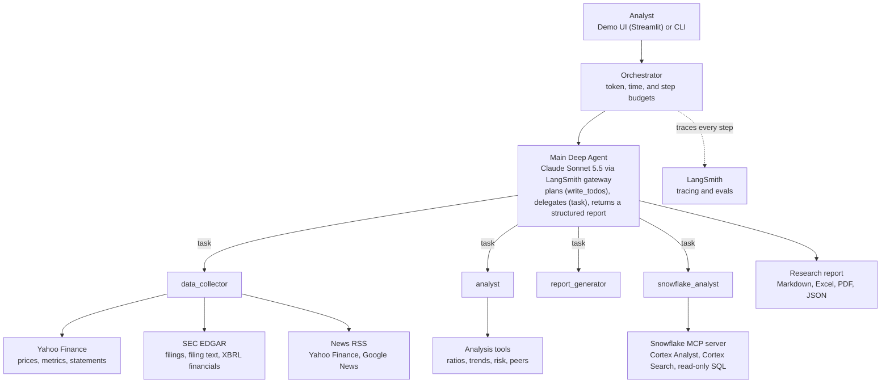

# Financial Deep Research Agent

An AI research agent that plans multi-step financial research, delegates to specialist
subagents, and returns a cited report. It combines public market data, SEC filings, news, and
the firm's internal research data in Snowflake.

## Architecture



| Component | Role |
|---|---|
| **Main Deep Agent** | Decides whether a request is a quick question or full research, writes a plan, delegates to subagents, and synthesizes a structured, cited `ResearchReport`. |
| **data_collector** | Public data: Yahoo Finance prices and statements, SEC EDGAR filings and as-reported XBRL financials, and news from public RSS feeds. No paid API keys. |
| **analyst** | Ratios, trends, risk assessment, and peer comparison on the data it is given. |
| **report_generator** | Drafts report narrative for full research requests. |
| **snowflake_analyst** | Read-only access to internal research data through Snowflake's managed MCP server. Writes are blocked by the Snowflake role, the server config, and a client-side SQL guard. |
| **Orchestrator** | Runs the agent with token, time, and step limits and tags each run for LangSmith. |
| **LangSmith** | Traces every plan, delegation, tool call, and token. Hosts the evaluation suite. Also serves as the LLM gateway for Anthropic models. |

Each subagent works in its own context, so the main agent sees summaries rather than raw
filings and statements. That keeps long, document-heavy research affordable and focused.

## Installation

Requires Python 3.10+.

1. Clone the repo:
   ```bash
   git clone https://github.com/langchain-samples/deep_agent_financial_research.git
   cd deep_agent_financial_research
   ```

2. Install the package with all extras (UI, evals, tests) using [uv](https://docs.astral.sh/uv/):
   ```bash
   uv sync --all-extras
   source .venv/bin/activate
   ```

3. Configure environment variables:
   ```bash
   cp .env.example .env
   ```
   Then fill in:
   - `OPENAI_API_KEY` or `ANTHROPIC_API_KEY`, plus `DEFAULT_MODEL_PROVIDER` and `DEFAULT_MODEL`
   - `SEC_USER_AGENT`: your name/company and email (SEC EDGAR requires it; no key needed)
   - `LANGSMITH_API_KEY`: optional, for tracing and evals
   - `SNOWFLAKE_MCP_URL` and `SNOWFLAKE_PAT`: optional, enables the `snowflake_analyst` subagent

4. Run it:
   ```bash
   streamlit run ui/app.py                         # demo UI
   python -m finance_research_agent.main AAPL      # CLI
   python -m evals.run_evals                       # LangSmith evals
   ```

See [docs/TECHNICAL.md](docs/TECHNICAL.md) for configuration details and
[docs/DEMO_QUESTIONS.md](docs/DEMO_QUESTIONS.md) for sample questions.
