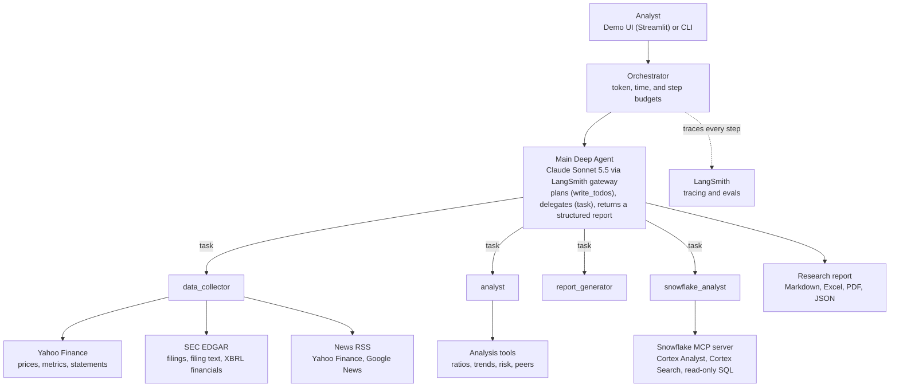

# Financial Deep Research Agent

An AI research agent that plans multi-step financial research, delegates to specialist
subagents, and returns a cited report. It combines public market data, SEC filings, news, and
the firm's internal research data in Snowflake.

## Architecture

| Component | Role |
|---|---|
| **Main Deep Agent** | Decides whether a request is a quick question or full research, writes a plan, delegates to subagents, and synthesizes a structured, cited `ResearchReport`. |
| **data_collector** | Public data: Yahoo Finance prices and statements, SEC EDGAR filings and as-reported XBRL financials, and news from public RSS feeds. No paid API keys. |
| **analyst** | Ratios, trends, risk assessment, and peer comparison on the data it is given. |
| **report_generator** | Drafts report narrative for full research requests. |
| **snowflake_analyst** | Read-only access to internal research data through Snowflake's managed MCP server. Writes are blocked by the Snowflake role, the server config, and a client-side SQL guard. |
| **Orchestrator** | Runs the agent with token, time, and step limits and tags each run for LangSmith. |
| **LangSmith** | Traces every plan, delegation, tool call, and token. Hosts the evaluation suite. Also serves as the LLM gateway for Anthropic models. |

Each subagent works in its own context, so the main agent sees summaries rather than raw
filings and statements. That keeps long, document-heavy research affordable and focused.

**Run it:** `streamlit run ui/app.py` for the demo UI, or
`python -m finance_research_agent.main AAPL` from the command line. Setup and configuration
are in [docs/TECHNICAL.md](docs/TECHNICAL.md), and sample questions are in
[docs/DEMO_QUESTIONS.md](docs/DEMO_QUESTIONS.md).

---

# Demo Talk Track

## Executive Summary

**Transform your financial research workflow from hours to minutes with AI-powered deep research agents.**

The Financial Deep Research Agent leverages cutting-edge AI technology to automate comprehensive financial analysis, delivering institutional-grade research reports in minutes instead of days. Built on LangChain Deep Agents, this solution represents the next generation of financial research automation.

---

## The Challenge: Why Financial Services Needs This

### Current Pain Points

**Time-Consuming Research Process**
- Analysts spend 60-80% of their time on data collection and basic analysis
- Manual research across multiple sources (Yahoo Finance, SEC filings, news articles) takes hours per company
- Inconsistent research quality due to human fatigue and time constraints

**Information Overload**
- Multiple data sources with different formats and update frequencies
- Difficulty synthesizing quantitative and qualitative information
- Risk of missing critical information in time-sensitive decisions

**Scalability Limitations**
- Limited ability to research multiple companies simultaneously
- High cost of scaling research teams
- Inability to provide real-time research updates

**Quality and Compliance Concerns**
- Inconsistent report formatting and structure
- Difficulty tracking data sources and citations
- Risk of human error in calculations and analysis

---

## The Solution: Deep Research Agents

### What Makes This Different?

**Intelligent Automation, Not Just Automation**

Unlike simple data scrapers or basic chatbots, our Deep Research Agent uses **advanced AI orchestration** to:
- **Plan** complex multi-step research tasks
- **Delegate** specialized work to expert subagents
- **Verify** completeness and quality at each step
- **Replan** when gaps are detected
- **Synthesize** findings into comprehensive reports

This is **autonomous research** - the agent thinks, plans, executes, and validates just like a human analyst, but faster and more consistently.

---

## Core Technology: The Power of Deep Agents

### LangChain DeepAgents - The Foundation

**What It Is:**
LangChain DeepAgents is a specialized framework for building AI agents that can handle complex, multi-step tasks requiring planning, context management, and specialized expertise.

**Why It Matters for Financial Services:**

1. **Planning & Task Decomposition**
   - The agent automatically breaks down complex research into manageable steps
   - Creates a structured plan: data collection → analysis → risk assessment → reporting
   - Ensures nothing is missed in the research process
   - **Value**: Eliminates the need for manual project management of research tasks

2. **Filesystem Management**
   - Stores intermediate results and context to manage large research tasks
   - Maintains research history and audit trails
   - Enables resumable research if interrupted
   - **Value**: Provides transparency, compliance documentation, and enables research continuity

3. **Subagent Delegation**
   - Specialized subagents for different aspects of research:
     - **Data Collector**: Expert at gathering data from multiple sources
     - **Financial Analyst**: Expert at calculations, ratios, and risk assessment
     - **Report Generator**: Expert at creating professional, structured reports
   - Each subagent operates with context isolation, preventing information overload
   - **Value**: Ensures expert-level quality in each domain while maintaining efficiency

**Real-World Impact:**
- **Before**: Analyst manually switches between data sources, Excel, analysis tools, and report templates
- **After**: Agent orchestrates specialized subagents, each focused on their expertise, with automatic handoffs

---

### Why Deep Agents, Not Plain LangChain or LangGraph?

LangChain offers three ways to build an agent. They are layers, not competitors: Deep Agents is
built on LangChain and LangGraph, so choosing it gives up nothing underneath.

| | LangChain `create_agent` | LangGraph | **Deep Agents** |
|---|---|---|---|
| **What it is** | A tool-calling loop | A low-level graph runtime where you define every step | An agent harness with planning, delegation, and context management built in |
| **Who decides the steps** | The model, in one flat loop | The developer, in code | The model, through an explicit plan it maintains |
| **Planning** | Build it yourself | Hard-code it as nodes and edges | Built in (`write_todos`) |
| **Specialist subagents** | Build it yourself | Build a subgraph per specialist | Built in (`task` tool), each with its own tools and prompt |
| **Large intermediate data** | Everything stays in one context window | You design the state | Subagents and a virtual filesystem keep the main context small |
| **Best for** | Focused, single-purpose assistants | Deterministic, auditable workflows | Open-ended, multi-step research |

**Why that matters for financial research:**

1. **Research questions don't follow one script.**
   - A full company report, a peer comparison, a proxy-statement review, and a question about
     internal coverage each need a different sequence of steps.
   - With LangGraph, each new question type means new graph code. The first version of this
     project hard-coded a fixed plan → collect → analyze → report pipeline and was rebuilt for
     exactly this reason.
   - With Deep Agents, the agent writes a plan for each question, and new question types need
     no new orchestration code.
   - **Value:** Analysts can ask what they actually need to know, not only what was anticipated.

2. **Research generates more data than one context window can hold.**
   - A single 10-K runs to hundreds of thousands of characters. Financial statements, price
     history, and news add more.
   - In a single `create_agent` loop, all of it piles into one context, which drives up cost
     and buries the important details.
   - Deep Agents gives each specialist its own context. In our test run, the data collector made
     14 tool calls and read about 40,000 tokens of filings and statements, and the main agent
     received only its summary.
   - **Value:** Lower cost per report and more reliable synthesis on long, document-heavy tasks.

3. **Specialists are configuration, not engineering projects.**
   - Each subagent is a name, a description, a prompt, and a list of tools.
   - The Snowflake subagent for internal research data was added this way. It connects to
     Snowflake's MCP server, and the main agent learns what data exists from the tool
     descriptions.
   - The same pattern adds a fixed income, fund holdings, or ESG data specialist later.
   - **Value:** New data sources plug in in days, not months.

4. **You still get the production foundation underneath.**
   - Deep Agents runs on LangGraph's runtime, so streaming, checkpointing, human-in-the-loop
     approvals, and deployment come with it.
   - It is traced end to end in LangSmith: every plan, delegation, tool call, and token.
   - Around it, this agent adds token and time budgets, read-only enforcement for internal
     data, and a structured, cited report format.
   - **Value:** Flexibility for open-ended research without giving up controls.

**When we'd recommend something else:** For a fixed, regulated process where every run must
follow the same steps (for example, a KYC approval workflow), LangGraph's explicit graph is the
better fit. For a simple single-purpose assistant, `create_agent` is enough. Open-ended
investment research is the case Deep Agents was designed for.

---

## How It Works: The Research Process

### Step 1: Intelligent Planning
The agent receives a research request (e.g., "Research Apple Inc.") and automatically creates a comprehensive plan:
- Collect stock information and metrics
- Gather financial statements
- Retrieve SEC filings
- Collect recent news and sentiment
- Perform financial analysis
- Assess risk profile
- Generate comprehensive report

**Value**: No manual project planning required - the agent thinks through the entire research process.

### Step 2: Specialized Data Collection
The **Data Collector Subagent** takes over:
- Fetches real-time stock data from Yahoo Finance
- Retrieves historical financial statements
- Searches and extracts SEC filings (10-K, 10-Q, 8-K)
- Gathers relevant news articles
- Analyzes market sentiment

**Value**: Comprehensive data gathering from multiple sources in parallel, ensuring nothing is missed.

### Step 3: Expert Financial Analysis
The **Financial Analyst Subagent** performs:
- Calculates key financial ratios (P/E, P/B, ROE, ROA, etc.)
- Compares company metrics to industry peers
- Assesses risk factors (beta, debt-to-equity, profitability trends)
- Analyzes revenue and earnings trends
- Identifies strengths and weaknesses

**Value**: Institutional-grade analysis without requiring a CFA on every research task.

### Step 4: Professional Report Generation
The **Report Generator Subagent** creates:
- Executive summary with key findings
- Structured financial analysis
- Risk assessment and recommendations
- Citations and data source tracking
- Multiple formats (Excel, PDF, Markdown, JSON)

**Value**: Consistent, professional reports ready for stakeholders, clients, or regulatory submission.

### Step 5: Quality Control
Throughout the run:
- The agent tracks its plan as a todo list and re-delegates when data is missing
- Every figure in the final report must come from a subagent result, with its source cited
- Gaps go into an explicit **Limitations** section instead of being estimated
- Token and time budgets cap every run
- Each run is traced in LangSmith, and an evaluation suite scores reports for completeness,
  sourcing, and groundedness

**Value**: Research quality you can inspect and measure, not just trust.

---

## Value Proposition for Financial Services

### For Investment Firms

**Portfolio Research at Scale**
- Research 50+ companies in the time it takes to research 5 manually
- Consistent quality across all research reports
- Real-time updates as new information becomes available
- **ROI**: Enable analysts to focus on high-value strategic work instead of data gathering

**Due Diligence Acceleration**
- Comprehensive company research in minutes for M&A opportunities
- Automated risk assessment and red flag detection
- Consistent documentation for compliance
- **ROI**: Faster deal evaluation, more opportunities evaluated

### For Wealth Management

**Client Portfolio Analysis**
- Automated research for client portfolio holdings
- Regular updates on portfolio companies
- Risk assessment and rebalancing recommendations
- **ROI**: Scale personalized service without scaling headcount

**Market Intelligence**
- Continuous monitoring of market sectors
- Automated news and sentiment analysis
- Early warning system for portfolio risks
- **ROI**: Proactive client communication and risk management

### For Banks & Credit Analysis

**Credit Risk Assessment**
- Automated financial analysis for loan applications
- Consistent risk scoring across all applicants
- Comprehensive documentation for regulatory compliance
- **ROI**: Faster loan processing, better risk management

**Regulatory Reporting**
- Automated generation of required financial reports
- Complete audit trails and data source citations
- Consistent formatting for regulatory submission
- **ROI**: Reduced compliance costs and faster reporting cycles

### For Research Departments

**Research Productivity**
- 10x increase in research output per analyst
- Consistent quality and formatting
- Automated citation and source tracking
- **ROI**: More research coverage with existing team

**Knowledge Management**
- Structured, searchable research reports
- Historical research archive
- Trend analysis across time periods
- **ROI**: Better institutional knowledge and decision-making

---

## Key Differentiators

### 1. **True AI Orchestration, Not Just Automation**
- The agent **thinks** and **plans**, not just executes predefined scripts
- Adapts to different research requirements automatically
- Handles edge cases and data quality issues intelligently

### 2. **Specialized Expertise Through Subagents**
- Each subagent is an expert in its domain
- Context isolation prevents information overload
- Ensures quality in each aspect of research

### 3. **Production-Ready Reliability**
- Durable execution handles failures gracefully
- Budget management prevents cost overruns
- Verification ensures quality standards

### 4. **Comprehensive Integration**
- Multiple data sources (Yahoo Finance, SEC, News APIs)
- Multiple output formats (Excel, PDF, Markdown, JSON)
- Flexible configuration for different use cases

### 5. **Transparency & Compliance**
- Complete audit trails
- Data source citations
- Credibility scoring for information quality
- Structured documentation for regulatory requirements

---

## Why LangChain Outperforms Competitors

### LangChain vs. AutoGPT / AgentGPT

**The Problem with AutoGPT:**
- **Unstable Loops**: AutoGPT agents can fall into infinite loops without clear stopping criteria
- **No State Management**: Loses context between runs, requires starting from scratch
- **Limited Production Use**: Primarily experimental, not designed for enterprise deployment
- **No Budget Controls**: Can burn through API costs without limits

**LangChain Advantages:**
- **Explicit Planning**: Deep Agents track a plan and delegate to focused subagents instead of looping open-endedly
- **Hard Limits**: Step, token, and time budgets stop runaway runs
- **Production-Ready**: Battle-tested in enterprise environments with monitoring, logging, and error handling
- **Budget Management**: Token tracking and cost controls built into the framework
- **Impact**: Reliable, cost-controlled execution suitable for mission-critical financial research

### LangChain vs. CrewAI

**The Problem with CrewAI:**
- **Static Role Assignment**: Agents have fixed roles that can't adapt to task requirements
- **Limited Context Sharing**: Agents work in silos, leading to information duplication
- **Basic Task Delegation**: Simple sequential or hierarchical task assignment only
- **No Filesystem Management**: All context must be held in memory, limiting complexity

**LangChain Advantages:**
- **Dynamic Agent Specialization**: DeepAgents create subagents tailored to specific research needs on-the-fly
- **Context Isolation with Sharing**: Each subagent has focused context but can access shared filesystem for comprehensive view
- **Intelligent Delegation**: Agents can delegate, verify, and replan based on quality checks
- **Persistent State Management**: Filesystem storage enables complex, long-running research with full audit trails
- **Impact**: More sophisticated research workflows that handle complex financial analysis with institutional-grade documentation

### LangChain vs. Microsoft Semantic Kernel

**The Problem with Semantic Kernel:**
- **.NET-Centric**: Primarily designed for .NET ecosystems, limiting Python data science integration
- **Function-Based**: Treats AI as functions rather than autonomous agents
- **Manual Orchestration**: Requires explicit orchestration code for complex workflows
- **Limited Community Tools**: Smaller ecosystem of pre-built integrations

**LangChain Advantages:**
- **Python-Native**: Seamless integration with pandas, NumPy, scikit-learn, and Python financial libraries
- **Agent-First Design**: Built from the ground up for autonomous agent workflows
- **Self-Orchestrating Agents**: Deep Agents plan and coordinate their own work, with no orchestration code per question type
- **Rich Ecosystem**: 700+ pre-built integrations with data sources, tools, and services
- **Impact**: Faster development with better integration into Python-based financial tech stacks

### LangChain vs. Haystack

**The Problem with Haystack:**
- **Document-Centric**: Optimized for RAG and document search, not multi-step agentic workflows
- **Pipeline Rigidity**: Linear pipelines that don't support dynamic decision-making
- **Limited Agent Capabilities**: Basic question-answering agents, not autonomous researchers
- **No Task Planning**: Executes predefined steps without adaptive planning

**LangChain Advantages:**
- **Multi-Step Agentic Workflows**: DeepAgents plan, execute, verify, and replan autonomously
- **Dynamic Execution**: Deep Agents choose their steps, delegate in parallel, and keep going until the plan is complete
- **Full Agent Autonomy**: Agents make decisions, delegate work, and ensure quality without human intervention
- **Planning & Verification**: Built-in capabilities for task decomposition and completeness checking
- **Impact**: True autonomous research that handles complex financial analysis end-to-end

### LangChain vs. LlamaIndex

**The Problem with LlamaIndex:**
- **Retrieval-Focused**: Excellent for querying documents but limited for orchestrating complex workflows
- **Single-Agent Model**: No native support for multi-agent collaboration and delegation
- **No Workflow State Management**: Stateless queries, not suitable for long-running research processes
- **Limited Tool Integration**: Focused on data connectors, not action-taking tools

**LangChain Advantages:**
- **Complete Agent Framework**: Deep Agents provide planning, delegation, and state management, not just retrieval
- **Multi-Agent Collaboration**: DeepAgents enable specialized subagents working together on complex tasks
- **Stateful Execution**: Maintains research state across multiple steps, data sources, and analysis phases
- **Comprehensive Tool Ecosystem**: 700+ integrations for both data retrieval and actions (API calls, calculations, file generation)
- **Impact**: End-to-end research automation from data collection through analysis to report generation

### LangChain vs. Custom OpenAI API Solutions

**The Problem with Custom Solutions:**
- **Reinventing the Wheel**: Teams waste months building orchestration, memory, and tool integration
- **Maintenance Burden**: Custom code requires ongoing updates as LLM APIs evolve
- **No Best Practices**: Teams learn hard lessons that framework communities already solved
- **Limited Observability**: Building monitoring, logging, and debugging capabilities from scratch

**LangChain Advantages:**
- **Production-Proven Patterns**: Deep Agents embody years of community best practices
- **Maintained Framework**: Automatic updates for new LLM features, API changes, and security patches
- **Built-in Observability**: LangSmith provides comprehensive monitoring, tracing, and debugging
- **Rapid Development**: Build in weeks what would take months with custom solutions
- **Impact**: Faster time-to-market with lower maintenance costs and better reliability

### The LangChain Ecosystem Advantage

**Why LangChain Dominates for Financial AI Applications:**

1. **Maturity & Adoption**: 85k+ GitHub stars, used by thousands of enterprises, battle-tested in production
2. **Comprehensive Platform**:
   - **LangChain**: 700+ integrations and reusable components
   - **DeepAgents**: Specialized framework for autonomous multi-agent systems
   - **LangSmith**: Production observability and monitoring
3. **Financial Services Integration**: Pre-built connectors for Yahoo Finance, SEC EDGAR, Bloomberg, Refinitiv
4. **Enterprise Support**: Commercial backing, security audits, compliance documentation
5. **Active Community**: Rapid issue resolution, extensive documentation, continuous innovation
6. **Flexible Deployment**: Cloud, on-premises, or hybrid with your choice of LLM providers

**The Result**: The only framework that delivers production-grade, autonomous financial research at scale.

---

## Technical Architecture Highlights

### Modular Design
- **Tools**: Reusable components for data collection, analysis, and reporting
- **Subagents**: Specialized agents that can be customized or extended
- **Workflow**: Configurable research process that adapts to requirements

### Extensibility
- Easy to add new data sources
- Simple to add new analysis capabilities
- Straightforward to customize report formats
- **Value**: Grows with your business needs

### Enterprise-Ready
- Budget controls for cost management
- Error handling and retry logic
- Comprehensive logging and monitoring
- Configuration management
- **Value**: Production deployment without additional engineering

---

## Use Cases & Examples

### Use Case 1: Daily Market Research
**Scenario**: Research team needs to analyze 20 companies daily for market updates.

**Traditional Approach:**
- 2-3 hours per company
- 40-60 hours total
- Requires 5-6 analysts
- Inconsistent quality

**With Deep Research Agent:**
- 5-10 minutes per company
- 2-3 hours total
- Requires 1 analyst for review
- Consistent, high-quality reports

**Impact**: 20x time savings, 80% cost reduction

### Use Case 2: M&A Due Diligence
**Scenario**: Evaluate acquisition target with comprehensive financial analysis.

**Traditional Approach:**
- 1-2 weeks for comprehensive research
- Multiple analysts working in parallel
- Risk of missing critical information
- Inconsistent documentation

**With Deep Research Agent:**
- 1-2 hours for comprehensive research
- Single analyst for strategic review
- Systematic coverage of all aspects
- Complete documentation and audit trail

**Impact**: 10x faster evaluation, better decision-making

### Use Case 3: Client Portfolio Review
**Scenario**: Quarterly review of 100+ client portfolios.

**Traditional Approach:**
- Manual research for each holding
- 2-3 weeks for complete review
- High cost and resource requirements
- Delayed client communication

**With Deep Research Agent:**
- Automated research for all holdings
- 1-2 days for complete review
- Minimal resource requirements
- Real-time client updates

**Impact**: 10x faster reviews, improved client service

---

## ROI & Business Impact

### Time Savings
- **Research Time**: 90% reduction (hours → minutes)
- **Report Generation**: 95% reduction (manual → automated)
- **Quality Review**: 80% reduction (automated verification)

### Cost Savings
- **Analyst Time**: Redirect 60-80% of time to high-value strategic work
- **Scaling Costs**: Research 10x more companies without 10x headcount
- **Error Costs**: Reduced errors through automated calculations and verification

### Quality Improvements
- **Consistency**: 100% consistent formatting and structure
- **Completeness**: Systematic coverage ensures nothing is missed
- **Accuracy**: Automated calculations reduce human error
- **Documentation**: Complete audit trails and citations

### Competitive Advantages
- **Speed**: Faster research enables faster decision-making
- **Scale**: Research more opportunities with same resources
- **Quality**: Institutional-grade research for all use cases
- **Innovation**: Enable new services that weren't economically viable before

---

## Getting Started

### Quick Start
1. **Install**: `pip install -e ".[ui]"`
2. **Configure**: `cp .env.example .env`, then add model, LangSmith, and (optionally) Snowflake credentials
3. **Run**: `streamlit run ui/app.py`, or `python -m finance_research_agent.main AAPL --output-format all`
4. **Review**: Quick answers in under a minute, full reports in 3-5 minutes, every run traced in LangSmith

See [docs/TECHNICAL.md](docs/TECHNICAL.md) for full setup.

### Integration Options
- **Standalone**: Run as independent research tool
- **API Integration**: Integrate into existing systems
- **Customization**: Extend for specific use cases
- **Enterprise**: Deploy with enterprise controls

---

## Why This Technology Matters

### The Future of Financial Research

Financial services is entering an era where **AI agents** augment human expertise, not replace it. The Deep Research Agent represents this future:

- **Augments Analyst Expertise**: Frees analysts from repetitive tasks to focus on strategy
- **Scales Institutional Knowledge**: Makes expert-level research accessible at scale
- **Ensures Quality**: Systematic processes guarantee consistent, high-quality output
- **Enables Innovation**: New services and capabilities become economically viable

### Built on Proven Technology

- **LangChain**: Industry-standard framework for LLM applications
- **DeepAgents**: Battle-tested architecture for complex agentic tasks

This isn't experimental technology - it's production-ready, enterprise-grade AI orchestration.

---

## Conclusion

The Financial Deep Research Agent transforms financial research from a time-consuming, manual process into an automated, intelligent workflow. By leveraging LangChain Deep Agents, it delivers:

✅ **10x faster research** - Minutes instead of hours  
✅ **Consistent quality** - Institutional-grade every time  
✅ **Complete coverage** - Nothing missed, everything documented  
✅ **Production-ready** - Enterprise controls and reliability  
✅ **Extensible** - Grows with your business needs  

**The question isn't whether AI will transform financial research - it's whether you'll be leading that transformation or following.**

---

## Next Steps

1. **See It In Action**: Request a live demonstration
2. **Try It Yourself**: Get access to the agent for your own research
3. **Customize for Your Needs**: Work with us to adapt it for your specific use cases
4. **Deploy at Scale**: Integrate into your existing workflows

**Ready to transform your financial research? Let's talk.**
